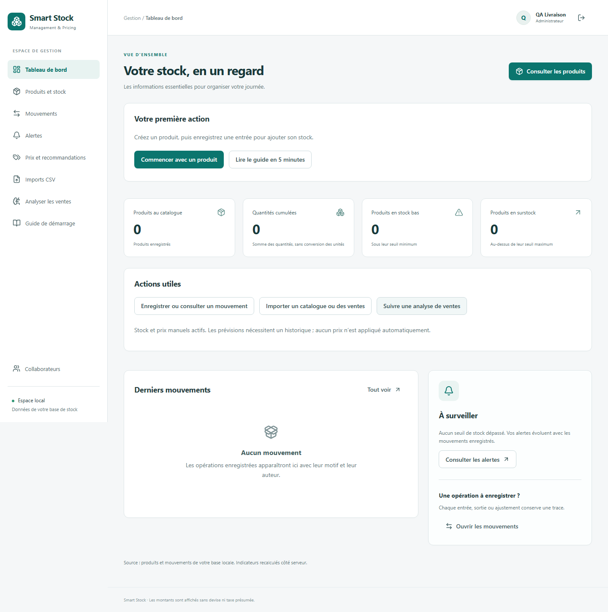
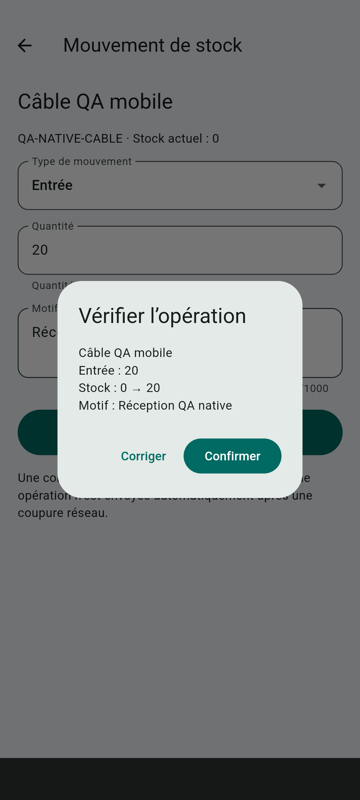
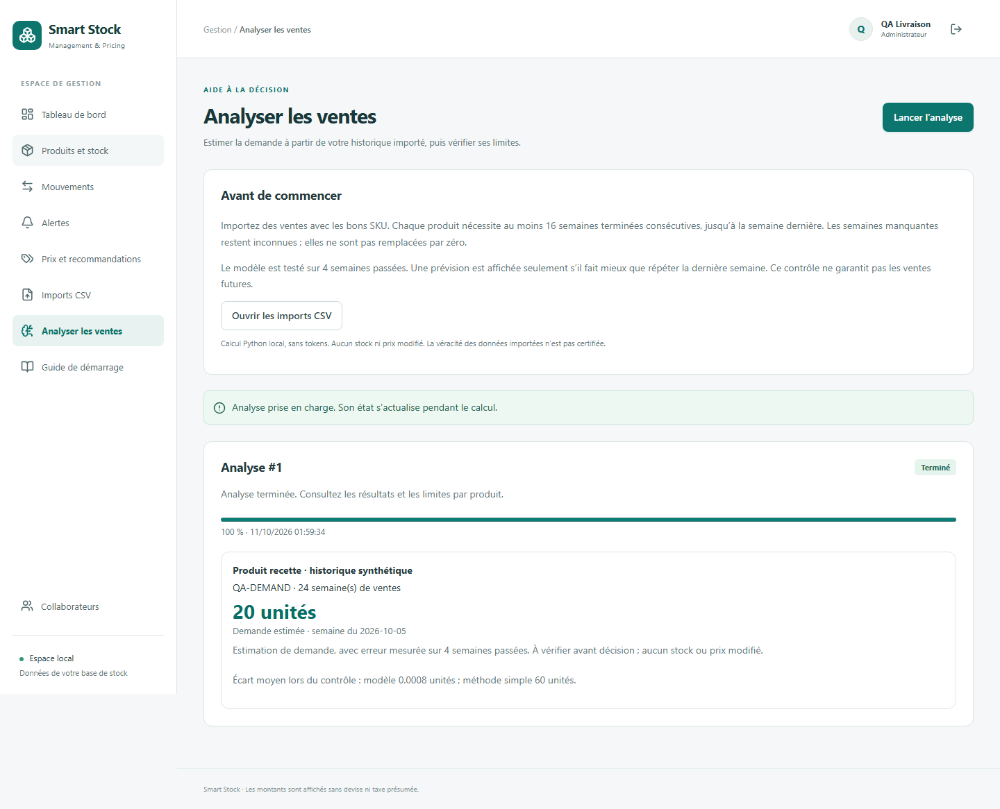

# Commencer en 5 minutes

Ce guide explique l’usage quotidien après installation. Pour installer le service ou l’application Android/iOS, utilisez [le guide technique](MOBILE_INSTALLATION.md) et [le README](../README.md).

## 1. Ouvrir votre espace

Le service doit être allumé sur votre ordinateur. Ouvrez [Smart Stock](http://127.0.0.1:8000). La première fois, renseignez votre nom, votre adresse e-mail et un mot de passe, puis cliquez sur **Créer mon espace**. Ensuite, utilisez **Se connecter**. Votre adresse sert d’identifiant ; aucun e-mail d’activation n’est envoyé.

## 2. Créer un produit

Votre boutique reçoit 20 câbles. Dans **Produits et stock**, cliquez sur **Ajouter un produit**. Saisissez le nom `Câble USB`, une **Référence / SKU** unique comme `CABLE-USB-01`, puis **Créer le produit**. Le stock commence à zéro. Chaque produit doit avoir sa propre référence.

## 3. Ajouter les 20 câbles

Ouvrez la fiche du produit. Cliquez sur **Enregistrer un mouvement**, choisissez **Entrée**, saisissez `20` et le motif `Réception fournisseur`. Cliquez sur **Vérifier le mouvement**, relisez le récapitulatif, puis **Confirmer le mouvement**. Attendez **Mouvement enregistré**. La fiche doit afficher 20 unités.

Pour une vente, choisissez **Sortie**. Pour un inventaire, **Ajustement** demande la quantité physique totale souhaitée, et non une différence à ajouter.

## 4. Consulter sur le téléphone

Après installation et connexion au même service, ouvrez l’application native **Smart Stock**. Utilisez le même compte que sur le web. Dans **Produits**, ouvrez le câble et vérifiez les 20 unités. Tirez l’écran vers le bas ou utilisez **Actualiser** pour recharger.

Sur mobile, un mouvement passe par **Vérifier le mouvement**, puis **Confirmer**. Attendez **Opération enregistrée par le service.** Une réponse perdue peut laisser une opération à reprendre : utilisez **Réessayer la même opération** ou la reprise proposée à l’accueil, sans en créer une deuxième.

Le mode local Android utilise un câble USB configuré lors de l’installation. L’accès depuis Internet et les notifications push ne sont pas activés.

## 5. Voir le résultat

**Mouvements** sur le web et **Historique** sur mobile montrent les opérations confirmées, leur motif et le stock avant/après. **Alertes** montre les produits sous leur minimum ou au-dessus de leur maximum. Réglez les seuils dans la fiche web du produit.

Pour changer un prix, ouvrez sa fiche, saisissez le nouveau montant et un motif, puis vérifiez et confirmez. Aucun prix n’est appliqué automatiquement.

Pour estimer la demande, utilisez **Imports CSV**, le modèle de ventes et l’aperçu avant confirmation, puis **Analyser les ventes**. Il faut au moins 16 semaines terminées consécutives jusqu’à la semaine dernière par produit. Si les données manquent ou si le modèle ne fait pas mieux que la méthode simple, une explication remplace l’estimation. Consultez les limites avant de décider.

## Si cela ne marche pas

| Situation | Action |
|---|---|
| Connexion impossible | Vérifier que le PC et le service sont allumés, l’adresse correcte et le tunnel USB actif en mode local. |
| Stock insuffisant | Vérifier la quantité et le stock actuel ; une sortie ne peut pas créer un stock négatif. |
| Produit modifié entre-temps | Actualiser, relire les valeurs et préparer une nouvelle opération après vérification de l’historique. |
| Réseau lent ou réponse perdue | Attendre le résultat. Réessayer la même opération avec les mêmes valeurs. Vérifier l’historique avant toute nouvelle saisie. |
| Session expirée ou révoquée | Se reconnecter. Si le compte est désactivé, contacter votre administrateur. |
| Prévision indisponible | Lire la raison affichée ; ne pas remplacer les semaines inconnues par des zéros. |

Un guide identique est accessible dans le menu **Guide de démarrage**. Les captures de ce document utilisent uniquement des comptes et données de recette.
