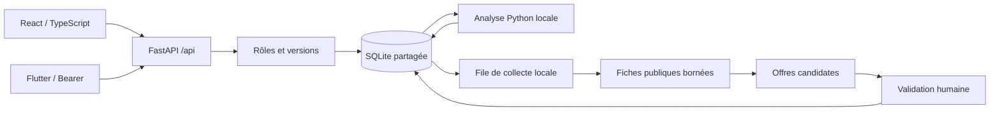

# Carte du projet Precios

Lire `AGENTS.md`, `PROJECT_PROGRESS.md` et `PROJECT_STATE.md` avant de modifier. L'existence d'un ancien fichier vide ne prouve pas une fonctionnalité. Les points actifs sont ci-dessous.

## Entrées et garanties

| Besoin | Fichiers |
|---|---|
| API, worker, protection Host/Origin, SPA | `services/api_gateway/app/main.py` |
| Base et migrations additives | `libs/common/database.py` |
| Auth/session/rôles | `libs/common/security.py`, `services/auth_service/app/api/routes` |
| Repository stock, version/idempotence | `services/stock_service/app/repositories/stock_repo.py` |
| Client HTTP web, montants | `frontend/src/api.ts` |
| Navigation et thème | `frontend/src/App.tsx`, `frontend/src/styles.css`, `frontend/src/ui.tsx` |
| Client HTTP natif, stockage sécurisé/reprise | `mobile/lib/services/api.dart` |
| Modèles/écrans natifs | `mobile/lib/models`, `mobile/lib/screens`, `mobile/lib/widgets` |

## Modules métier

Routes ci-dessous sous `services/stock_service/app/api/routes`, services sous `services/stock_service/app/services`, UI sous `frontend/src/features`.

| Module | Routes / service | UI et tests |
|---|---|---|
| CRM | `crm.py`, `opportunities.py` : `/crm/contacts`, notes/tasks, opportunités | `crm`, `test_crm.py`, `test_opportunities.py`, browser CRM/B2B |
| Commerce | `commerce.py`, `schemas/commerce_schemas.py`, service `commerce.py` : `/commerce/documents`, confirmation, retours | `commerce`, `test_commerce.py`, browser commerce/B2B |
| Imports | `imports.py`, `transaction_import.py` : `/imports/preview`, `/commit` | `imports`, tests imports/transaction_import et browser |
| Achats | `purchases.py` : `/purchases/orders`, confirm/receive/cancel | `purchases`, tests Python et browser achats |
| Réassort | `replenishment.py` route/service : policies/plan/draft | `replenishment`, tests budget/engagements/concurrence |
| Analyse | `insights.py`, service `insights.py` ; `analysis.py` route/service | `insights`, `analysis`, tests analyse/ML/insights |
| Veille manuelle | `market.py` : observations et produits | `market/MarketPage.tsx`, tests marché |
| Collecte | `collection.py`, `collection/{network,robots,parser,worker}.py` | `market/CollectionPanel.tsx`, `CollectionForms.tsx`, tests collecte |
| Décisions | `actions.py` route/service : `/actions`, `/actions/decisions` | `actions/ActionPanel.tsx`, tests décisions |
| Inventaires | `inventories.py` : campagne, lignes/count, apply/cancel | `inventories`, tests inventaires |
| Maintenance | gateway `api/routes/maintenance.py`, `libs/common/maintenance.py`, `scripts/maintenance.py` | `maintenance`, tests sauvegarde/restauration/récupération |

Le mobile utilise les mêmes endpoints : `screens/business/business_hub.dart`, `business_screen.dart`, `business_detail.dart`, `business_mutation.dart`, `market_product.dart`. Les opérations utilisent le brouillon sécurisé existant, jamais un retry d'écriture automatique.

## Flux commerciaux

1. Devis/brouillon → confirmation explicite → vente et mouvements atomiques → retours liés → contribution nette et données de demande.
2. Conditions fournisseur + stock + commandes/brouillons → proposition min/max → brouillon d'achat → commande → réceptions partielles → stock.
3. Identité canonique → URL activée → job durable → robots et GET public → extraction candidate → validation humaine → observation historique → comparaison à conditions égales.
4. Campagne → comptages versionnés sans stock → validation groupée des écarts → mouvements auditables.
5. Conditions d'alerte → décision motivée → historique. Acquitter ne supprime pas la condition ; une condition modifiée obtient une nouvelle empreinte.

## Exécution et recette

- `scripts/run.ps1` : service local, choix de base explicite.
- `scripts/create_recipe.py`, `scripts/run-recipe.ps1` : base synthétique séparée, aucun écrasement.
- `scripts/test.ps1` : Python, dépendances, build et diff.
- `tests/browser-*.mjs` : SQLite neuve et parcours Chromium ; `tests/package.json` liste les commandes.
- `tests/mobile_server.py`, `mobile/integration_test/{app_test,business_test}.dart` : backend QA et émulateur Android.
- `docs/evidence` : captures et preuves ; `runtime` : données et accès locaux ignorés par Git.

Les anciens services ML CSV sont conservés hors du circuit opérationnel. Ne pas désérialiser leurs joblib non vérifiés ou confondre leur ID produit avec un ID SQLite. La demande actuelle se calcule à partir des ventes enregistrées avec provenance et validation chronologique.
