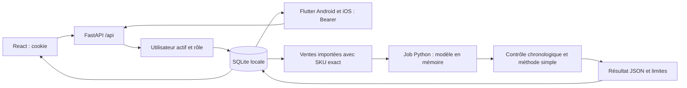
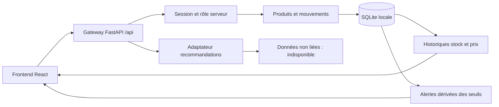

# Carte du projet

État local du 11 octobre 2026, à partir du commit initial 5b60a03. Le backend ML est conservé ; le cœur web et un client natif ont été ajoutés sans remplacer le dépôt distant.

## Extension native et analyse opérationnelle

| Besoin nouveau | Point de départ |
|---|---|
| Client Android/iOS et thème | mobile/lib/main.dart, mobile/android, mobile/ios |
| Session native, délais, HTTPS, brouillon de reprise | mobile/lib/services/api.dart |
| Écrans natifs | mobile/lib/screens : login, workspace, product_create, product_detail, operation |
| Jeton natif indépendant | services/auth_service/app/api/routes/mobile.py, libs/common/security.py |
| Désactivation et révocation globale | services/auth_service/app/api/routes/users.py, frontend/src/features/users/AccountActions.tsx |
| Tâches et déduplication | services/stock_service/app/api/routes/analysis.py |
| Prévision et validation chronologique | services/stock_service/app/services/analysis.py ; demand_model.py pour le réglage v2 et les trois références |
| Analyse web et aide utilisateur | frontend/src/features/analysis, frontend/src/features/help |
| Recette native sur backend réel | mobile/integration_test/app_test.dart, tests/mobile_server.py, tests/mobile-web-check.mjs |
| Régressions et recette livraison | tests/test_mobile_analysis.py, mobile/test, tests/browser-delivery.mjs |

API supplémentaires, toutes préfixées `/api` :

| Méthode | Route | Accès |
|---|---|---|
| POST | /mobile/auth/login | Identifiants, HTTPS ou client loopback pour recette USB ; limite commune avec login web |
| POST | /mobile/auth/logout | Jeton Bearer mobile ; révoque uniquement ce jeton |
| POST | /auth/users/{id}/access | ADMIN ; motif et active ; désactivation interdit sa propre session, conserve un ADMIN actif |
| POST | /auth/users/{id}/revoke-sessions | ADMIN ; ferme web/mobile sans supprimer le compte |
| POST / GET | /analysis/jobs | Écriture ADMIN/MANAGER ; lecture tout compte actif |

Ajouts SQLite par `CREATE TABLE IF NOT EXISTS` : `mobile_sessions`, `analysis_jobs`, `user_access`. Les sessions expirent après 12 h ; les comptes précédents sont actifs par défaut. Une désactivation révoque les sessions et conserve les historiques.

Le job prend un instantané explicite des produits et ventes importées. Le moteur v2 règle trois configurations sur deux périodes anciennes à partir de 24 semaines, puis compare quatre semaines séparées à trois références (dernière semaine, moyenne récente, répétition à quatre semaines). Il masque les prévisions si les données manquent ou si le modèle ne gagne pas. Les semaines inconnues ne deviennent pas des zéros. Empreinte + date + version de méthode permettent de signaler un résultat périmé. Aucun ancien joblib lu, aucune écriture de stock/prix, aucun service LLM ni tokens. Une tâche sans progression depuis dix minutes est signalée interrompue lors de la prochaine consultation ; `BackgroundTasks` ne constitue pas une file durable. Mesures et limites : DEMAND_OPTIMIZATION.md.

## Points d'entrée

| Partie | Entrée | Rôle |
|---|---|---|
| Application locale | services/api_gateway/app/main.py | create_app(db_path), middleware, routes /api, frontend compilé |
| Frontend | frontend/src/main.tsx puis App.tsx | session, navigation, écrans en français |
| Entraînement | services/ml_training_service/app/main.py | cinq entraînements, accès local seulement |
| Inférence | services/ml_inference_service/app/main.py | demande, risque, prix, promotions, restock, anomalies |
| Stockage | libs/common/database.py | SQLite et transactions |
| Adaptateur ML | libs/ml_bridge.py | indisponibilité explicite si données non liées ; aucun mélange implicite démo/réel |

## Flux du cœur

Le frontend utilise la même origine. Vite en développement proxifie /api vers le cœur en conservant Host. Les opérations sont validées et appliquées côté serveur, jamais seulement dans le navigateur.

## Fichiers utiles

| Besoin | Fichiers de départ |
|---|---|
| Session, mot de passe et droits | libs/common/security.py, services/auth_service/app/api/routes/auth.py, users.py, app/schemas/auth_schemas.py |
| Catalogue et prix appliqués | services/stock_service/app/api/routes/products.py, app/schemas/product_schemas.py |
| Mouvements, transactions, retry | services/stock_service/app/api/routes/stock.py, app/repositories/stock_repo.py, libs/common/database.py |
| Alertes et dashboard | services/alerts_service/app/api/routes/alerts.py, app/services/alert_service.py |
| API et types frontend | frontend/src/api.ts |
| Import CSV et ventes historiques | services/stock_service/app/api/routes/imports.py, frontend/src/features/imports/ImportsPage.tsx, docs/CSV_IMPORTS.md |
| Catalogue produits | frontend/src/Products.tsx |
| Fiche, formulaire et statut produit | frontend/src/features/products/ |
| Formulaire et historique des mouvements | frontend/src/features/stock/ |
| Prix, recommandation et historique | frontend/src/features/pricing/PricePanel.tsx |
| Dashboard, alertes, collaborateurs, design | frontend/src/pages.tsx |
| Composants et styles | frontend/src/ui.tsx, styles.css |
| Tests cœur | tests/test_stock_integration.py |
| Tests CSV | tests/test_imports.py, tests/browser-imports.mjs ; isolation bootstrap dans tests/conftest.py |
| Recette navigateur | tests/browser.mjs, tests/browser-design.mjs |
| ML isolé | tests/test_ml.py |

Les noms courts dans une cellule désignent le même répertoire que le chemin précédent. Certaines conventions originales models/repositories/schemas restent vides hors du périmètre complété. ml_data_service reste un squelette ; l'import métier est raccordé au service stock et ne déclenche aucun entraînement.

## API métier

Toutes les routes ci-dessous portent le préfixe /api. La session est requise sauf health, setup et login.

| Méthode | Route | Fonction / droits |
|---|---|---|
| GET | /health | santé locale |
| GET / POST | /auth/setup | statut puis premier administrateur, une seule fois |
| POST | /auth/login, /auth/logout | connexion / révocation session courante |
| GET | /auth/me | utilisateur connecté |
| GET / POST | /auth/users | liste / création de comptes, ADMIN |
| GET / POST | /products | catalogue / création, écriture ADMIN ou MANAGER |
| GET / PATCH | /products/{id} | fiche / métadonnées avec expected_version |
| PATCH | /products/{id}/price | application explicite, version et idempotency_key |
| GET | /products/{id}/prices | historique des prix |
| GET / POST | /movements | historique / opération atomique ; filtre product_id |
| GET | /alerts | règles stock < min ou stock > max |
| GET | /dashboard | indicateurs et mouvements récents |
| GET | /pricing/recommendations/{id} | limite ou recommandation si données explicitement liées |
| POST | /imports/preview | aperçu CSV sans écriture, ADMIN/MANAGER |
| POST | /imports/commit | revalidation et transaction entière, empreinte anti-doublon, ADMIN/MANAGER |
| GET | /imports, /imports/sales | 100 derniers imports / ventes, tous les rôles connectés |

Les sessions durent 12 h. Les mots de passe sont salés et dérivés avec PBKDF2 ; les jetons de session sont hachés en base. Les mutations contrôlent Origin et Host, sans CORS permissif. Stock et quantity sont bornés à 2147483647, les IDs aux entiers SQLite signés 64 bits. Les versions empêchent une écriture périmée ; l'idempotence empêche de compter un retry deux fois.

## Schéma local ajouté

La base sous runtime/ contient users, sessions, login_attempts, products, movements, price_history, idempotency, csv_imports et sales_history. L'évolution CSV ajoute les deux dernières tables par CREATE TABLE IF NOT EXISTS au démarrage local, sans remplacement des données existantes. Aucun schéma Supabase/SQL distant n'existait opérationnellement dans le dépôt. Les CSV démo restent séparés ; seul un import utilisateur explicitement confirmé enregistre les lignes validées.

Flux import : sélection CSV → aperçu serveur et rapprochement SKU → confirmation UI → revalidation sous BEGIN IMMEDIATE → création catalogue à stock zéro ou historique ventes séparé → journal de l'import. Empreinte kind/contenu/séparateur et références métier empêchent les doubles écritures. Une modification pertinente depuis l'aperçu impose une nouvelle analyse. Aucun export ML ni recommandation activé par l'import.

## Flux ML conservé

Les deux configs utilisent les mêmes DATA_DIR, MODELS_DIR et REPORTS_DIR ; valeurs par défaut racine data/, artifacts/models/, artifacts/reports/. Aucun dossier de données n'est créé à l'import. L'entraînement crée explicitement ses dossiers de sortie. Les 40 joblib historiques sont conservés mais ne sont pas acceptés sans provenance locale concordante.

| Service | Méthode | Route |
|---|---|---|
| Entraînement | GET | /health |
| Entraînement | POST | /train/all, /train/demand-ml, /train/price-ml, /train/anomaly-ml, /train/promo-ml |
| Inférence | GET | /health, /predict/demand-weekly/{product_id}, /predict/stock-risk/{product_id} |
| Inférence | GET | /recommend/price/{product_id}, /recommend/restock/{product_id}, /recommend/promo/{product_id}, /detect/anomalies/{product_id} |

/train/all produit les baselines et règles de stock ; il ne remplace pas les entraînements spécialisés. Les algorithmes restent dans les fichiers métier existants demand_ml_trainer, price_recommender, promo_recommender, anomaly_detectors et train_baselines côté training, demand_predictor, price_engine, promo_engine, restock_engine, anomaly_engine et stock_risk_predictor côté inference.

La probabilité de risque de stock demeure une heuristique. Les promotions ne mesurent pas un effet causal. La qualité prédictive réelle n'est pas évaluée. Voir PROJECT_STATE.md pour les fonctionnalités encore non livrées.
